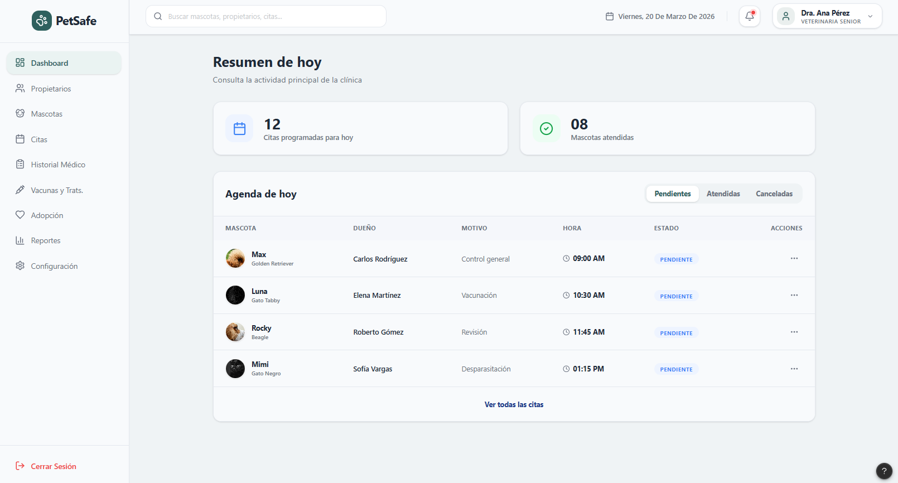

# PetSafe · Frontend

Interfaz web de PetSafe, una plataforma para operar una clínica veterinaria: propietarios y mascotas, citas, cola de atención en tiempo real, consultas, vacunas, tratamientos y adopciones. Consume la API de [PetSafe-Back](https://github.com/STRATIUM-UTA/PetSafe-Back).



## Módulos

| Área | Pantallas |
|---|---|
| Atención | Dashboard del día, citas, cola de atención en vivo, consultas (encounters) |
| Clínica | Casos clínicos, historial, vacunación, tratamientos y procedimientos |
| Pacientes | Propietarios y mascotas |
| Adopciones | Publicación, edición y seguimiento de adopciones |
| Gestión | Catálogos, reportes, notificaciones y configuración |
| Acceso | Inicio de sesión, recuperación de contraseña y páginas de error o sin permiso |

La cola de atención y las notificaciones se actualizan en tiempo real con Socket.IO (`src/app/core/realtime`).

## Stack

Angular 21 (componentes standalone) · Angular Material · Tailwind CSS 4 · RxJS · Socket.IO · Vitest · Playwright

## Ejecutar en local

Requisitos: Node.js 20+ y el backend corriendo en `http://localhost:3000`.

```bash
npm install
npm start            # http://localhost:4200
```

La URL de la API se configura en `src/environments/environment.development.ts` (desarrollo) y `src/environments/environment.ts` (producción).

## Pruebas y build

```bash
npm test             # pruebas unitarias con Vitest
npx playwright test  # pruebas end to end
npm run build        # salida en dist/
```

## Estructura

```text
src/app/
├── core/          # autenticación, configuración, errores, tiempo real, UI base
├── shared/        # componentes reutilizables
├── shell/         # layout principal y navegación
└── <módulo>/      # api, models, list, create, edit por cada área
```
